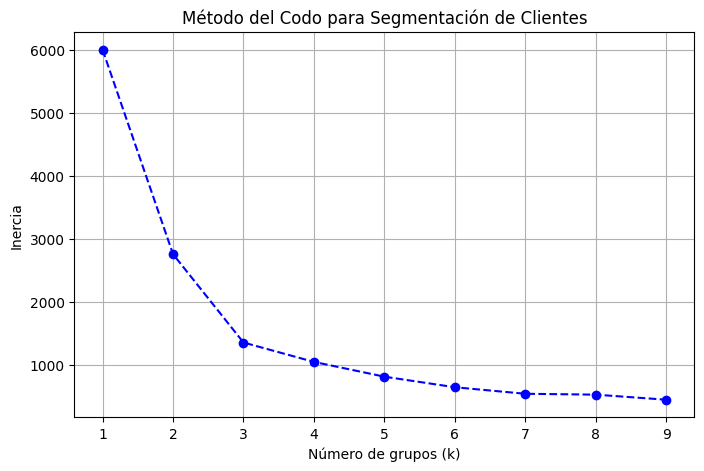
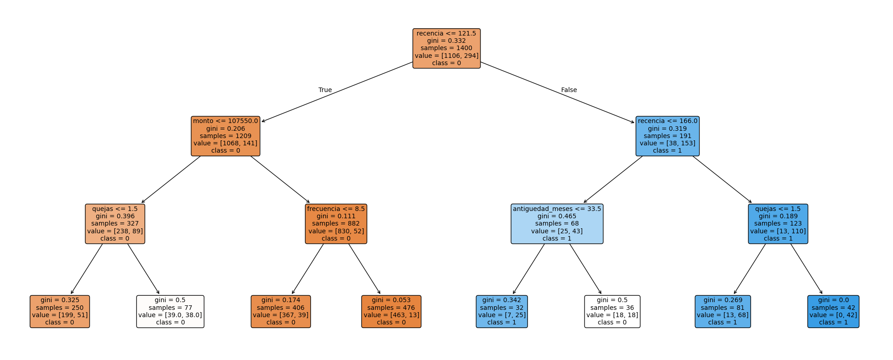
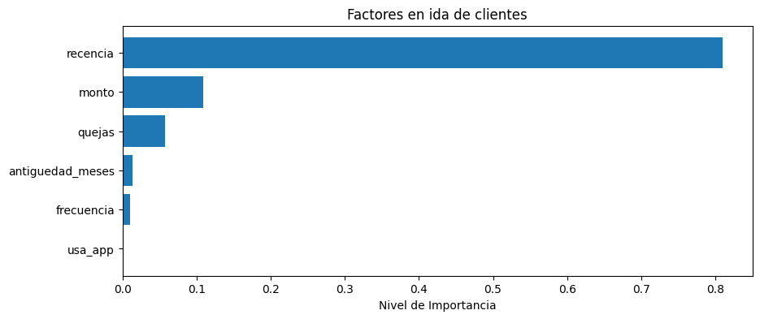

  <a href="README.md">English</a> | <a href="README.es.md"><strong>Español</strong></a>

# Predicción de Abandono y Segmentación de Clientes — TicoShop (Machine Learning)

Proyecto aplicado de **Machine Learning y Analítica de Clientes** para comercio electrónico (**TicoShop**), combinando segmentación no supervisada (**K-Means**) y predicción supervisada de deserción (**Árbol de Decisión**) para diseñar un plan de retención comercial.

---

## Metodología y Resultados

| Etapa | Técnica | Resultado Clave |
|---|---|---|
| **Análisis Exploratorio** | Mediana por estado (`se_fue`) | Clientes activos tienen recencia mediana de **24** frente a **132** en desertores; quienes se van compran menos de 3 veces al año (mediana **₡53,800**) |
| **Segmentación** | `StandardScaler` + `KMeans (k=3)` | 3 segmentos claros: **Clientes Premium**, **Clientes Regulares** y **Clientes Inactivos** |
| **Modelo Predictivo** | `DecisionTreeClassifier (max_depth=3)` | **86.17% de exactitud** sobre el conjunto de prueba (30%, `600` clientes) |
| **Factores de Riesgo** | Importancia de variables | La **recencia** es el principal indicador de abandono |

---

## Resultados Visuales

### 1. Segmentación de Clientes (K-Means)

### 2. Árbol de Decisión (`max_depth=3`)

### 3. Importancia de Factores

---

## Plan de Acción Comercial

1. **Priorizar clientes Premium y Regulares** ante las primeras señales de aumento en su recencia.
2. **Campañas de retención con beneficios por tiempo limitado** y programas de puntos para incentivar la recompra.
3. **Monitoreo preventivo de recencia** como alerta temprana para el equipo de mercadeo.
