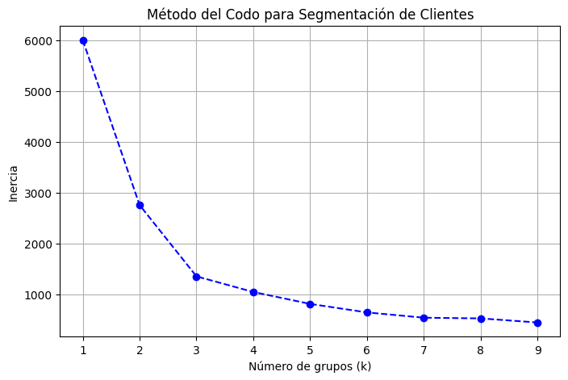
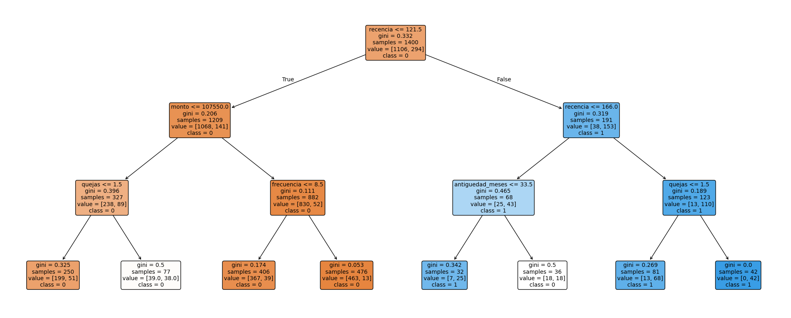
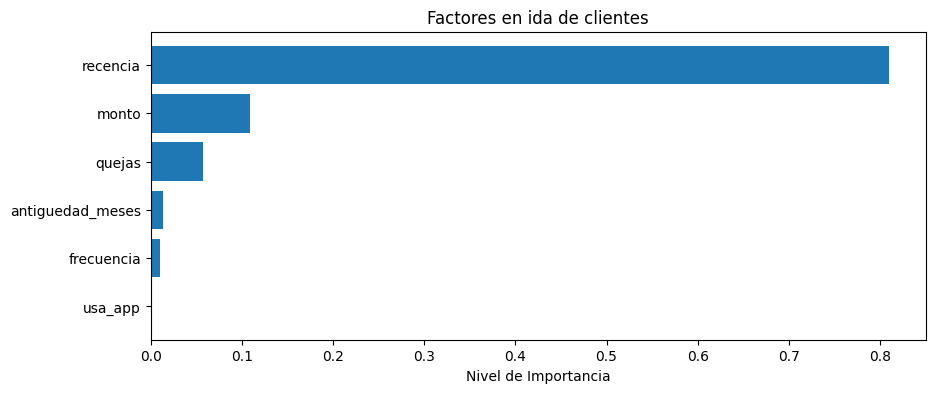

<div align="right">
  <a href="README.md"><strong>English</strong></a> | <a href="README.es.md">Español</a>
</div>

# TicoShop Customer Churn Prediction & Segmentation (Machine Learning)

Applied **Machine Learning & Customer Analytics** project for an e-commerce retail business (**TicoShop**), combining unsupervised customer segmentation (**K-Means**) and supervised churn prediction (**Decision Tree Classifier**) to drive targeted marketing retention actions.

---

## Project Objectives & Results

| Component | Technique | Key Output / Metric |
|---|---|---|
| **Exploratory Comparison** | Group-by Median Analysis | Active customers show median recency of **24** vs. **132** for churned customers; churned customers spent a median of **₡53,800** and bought < 3 times/year |
| **Customer Segmentation** | `StandardScaler` + `KMeans (k=3)` | 3 actionable segments: **Clientes Premium**, **Clientes Regulares**, **Clientes Inactivos** |
| **Churn Prediction** | `DecisionTreeClassifier (max_depth=3)` | **86.17% accuracy** on a 30% holdout test set (`600` test records) |
| **Risk Driver Analysis** | Tree Feature Importances | **Recency** (`recencia`) identified as the primary churn predictor |

---

## Visual Results

### 1. Customer Segmentation (K-Means)


### 2. Churn Decision Tree (`max_depth=3`)


### 3. Feature Importance


---

## Business Action Plan

1. **Prioritize Premium & Regular customers** showing early recency increases before they transition into inactivity.
2. **Launch time-limited retention campaigns** and loyalty point incentives tied to repeat purchase frequency.
3. **Monitor recency thresholds** proactively rather than waiting for long inactivity windows.

---

## Tech Stack & Structure

- **Language:** Python 3
- **Libraries:** `pandas`, `numpy`, `matplotlib`, `scikit-learn`

```text
├── notebooks/
│   └── ticoshop_churn_segmentation.ipynb   # Full analysis, clustering, model training & business plan
├── assets/
│   ├── kmeans_segments.png
│   ├── decision_tree.png
│   └── feature_importance.png
├── requirements.txt
└── .gitignore
```
